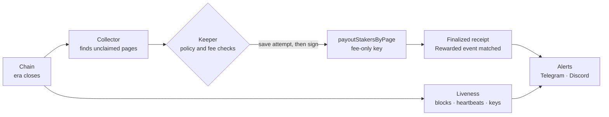
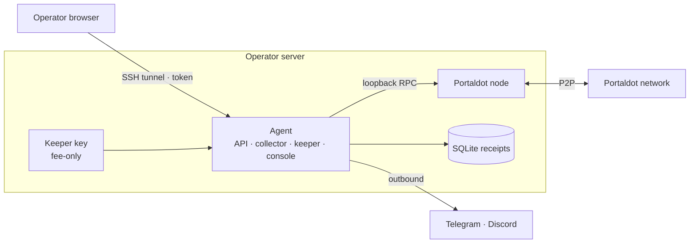

<div align="center">


# PortalNode

**Claims Portaldot staking rewards before they expire, and tells operators when their node needs attention.**<br>
A keeper, a liveness watch and alerts, packaged to run next to any Portaldot node.

[Live demo](https://portalnode.timidan.xyz) · [How it works](#how-it-works) · [Evidence](#evidence) · [Quickstart](#quickstart) · [Architecture](#architecture) · [API](#api)


[](LICENSE)

</div>


Portaldot pays staking rewards only when someone sends a payout transaction, and an unclaimed era is lost after 84 eras. Anyone may send it; usually nobody does. PortalNode sends it every era from a separate fee-only key, watches each validator's liveness the way the chain counts it, and alerts you on Telegram or Discord before something goes wrong.

> [!IMPORTANT]
> The keeper signs on the V3 testnet only. On mainnet PortalNode watches and alerts; keeper signing is switched off in code this round.

## Highlights

- **Claims every era.** `payoutStakersByPage` on V3, `payoutStakers` on runtime 1002, chosen from the runtime's shape.
- **Fee-only key.** The keeper key pays fees, nothing else. No stash or controller key touches the server.
- **Crash-safe, provable receipts.** Each attempt is saved before broadcast and settled only from a finalized receipt, kept with its block number and events so it outlives node pruning.
- **Liveness as the chain counts it.** Blocks authored or a heartbeat, per `pallet-im-online`. Warns before a validator is reported offline, and checks your node holds its session keys.
- **Alerts that clear, with the fix.** Telegram and Discord: one message when a problem starts, one when it ends, each with the step that fixes it.
- **Public status API.** `/api/status/<stash>`: how far any validator is paid, open to any wallet or dApp.
- **Setup wizard.** Bond, keys and validate in one batch, signed in Portaldot's Node Console.

## Built with

<table>
  <tr>
    <td align="center" width="170">
      
      <br><sub><b>Portaldot V3</b> · staking</sub>
    </td>
    <td align="center" width="170">
      
      <br><sub><b>tPOT / POT</b> · payouts</sub>
    </td>
    <td align="center" width="170">
      
      <br><sub><b>Portaldot node</b> · pinned binary</sub>
    </td>
  </tr>
</table>

Also used: `@polkadot/api`, Express, SQLite, React 19, Vite, Tailwind CSS v4, three.js, Docker Compose. Versions and licences: [docs/DEPENDENCIES.md](docs/DEPENDENCIES.md).

## How it works



1. **Collect.** On each session change, list every unclaimed era and page in the 84-era window.
2. **Check.** Re-read the claim marker, era bounds and runtime code hash. Apply the fee cap, 24-hour budget and reserve.
3. **Sign.** Save the attempt, then broadcast. One transaction in flight.
4. **Settle.** Count a payout only when a finalized block holds the extrinsic and its `Rewarded` event.
5. **Watch.** Liveness, keys and keeper health raise alerts that clear on their own.

## Evidence

On the V3 testnet nobody was claiming. On 18 Oct PortalNode claimed all 48 open payouts, then kept going on its own, about a minute after each era closed.

| | |
|---|---|
| Payouts claimed | **80** by 22 Oct (eras 1–40, both validators), all re-verified |
| Paid to validators | **137.70 tPOT** |
| Keeper account | `5HCFicFwm7GoC8R4swpr2WTFFvkH1WkzJQdVcsq6jMFDQVk3` |
| First payout | [`0x9825048e…`](https://node-console.portaldot.dev/?rpc=wss%3A%2F%2Ftest-node-v3.portaldot.dev#/explorer/query/0x8a413a135c18c6ec2349f16a3c24aa635f359db1ce7cf642e66d89f04590f62f) · block 90,847 |
| Live receipts | [`/api/receipts`](https://portalnode.timidan.xyz/api/receipts) |
| Full list | [docs/EVIDENCE.md](docs/EVIDENCE.md) |

Crash recovery, double-claim refusal and dev-chain tests: [docs/HARDENING-LOG.md](docs/HARDENING-LOG.md).

## Architecture



Two shapes: **add-on** (agent next to a node you already run) and **full** (pinned mainnet node plus agent). Design and security rules: [docs/ARCHITECTURE.md](docs/ARCHITECTURE.md).

## Quickstart

```bash
git clone https://github.com/Timidan/portalnode && cd portalnode/deploy
docker compose run --rm setup                    # chain, validators, keeper, Telegram/Discord
docker compose --profile addon up -d --build     # or --profile full
ssh -L 8080:127.0.0.1:8080 your-server           # then open http://127.0.0.1:8080/console
```

`setup` checks your validators on chain, can generate a fresh keeper key, finds your Telegram chat by itself and sends a test alert. It writes `.env`, `secrets/keeper.json` (owner-only) and `state/`.

> [!NOTE]
> The guided Docker flow is new (21 Oct). The live demo first ran from source: `cd agent && npm ci && npm run dev` with the variables below.

## Configuration

| Variable | Default | Purpose |
|---|---|---|
| `PORTALNODE_MODE` | `observer` | `operator` allows signing |
| `PORTALNODE_RPC` | `ws://127.0.0.1:9944` | Chain WebSocket |
| `PORTALNODE_GENESIS` | — | Required in operator mode |
| `PORTALNODE_ALLOWLIST` | — | Validator stashes to watch and claim for |
| `PORTALNODE_KEEPER_FILE` | — | Keeper key JSON, `chmod 600` |
| `PORTALNODE_KEEPER` | off | `on` starts the keeper at boot |
| `PORTALNODE_MAX_FEE` · `_BUDGET_24H` · `_MIN_RESERVE` | — | Fee policy |
| `PORTALNODE_TOKEN` | — | Bearer token for keeper routes |
| `PORTALNODE_TELEGRAM_BOT_TOKEN` · `_CHAT_ID` | — | Telegram alerts |
| `PORTALNODE_DISCORD_WEBHOOK` | — | Discord alerts |
| `PORTALNODE_ALERT_PAYOUTS` | off | Message per claimed payout |
| `PORTALNODE_NODE_RPC` · `PORTALNODE_METRICS` | — | Local node health (loopback) |
| `PORTALNODE_UPSTREAM_CHECK` | on | Alert on a new upstream node commit |
| `PORT` · `PORTALNODE_BIND` | `8080` · `0.0.0.0` | Listen port and address |

## API

| Route | Mode | Returns |
|---|---|---|
| `GET /api/health` · `/node` · `/network` | both | Agent, node and network state; keeper summary |
| `GET /api/rewards` · `/receipts` | both | Eras, attempts, re-verified receipts |
| `GET /api/liveness` | both | Per-validator blocks, heartbeats, era points, risk |
| `GET /api/nominator/:address` | both | Role, bond, unclaimed payouts |
| `GET /api/status/:stash` | both | Public, CORS-open: paid-through era and unpaid pages for any validator |
| `GET /api/wizard/preflight` · `/status` · `POST /api/wizard/build` | both | Setup wizard |
| `GET /api/alerts` | both | Channels and recent alerts |
| `POST /api/keeper/enable` · `/disable` · `/claim-now` · `PUT /api/keeper/policy` | operator | Keeper control, bearer token |
| `POST /api/alerts/test` · `/api/wizard/rotate-keys` | operator | Test alert, node keys |

## Project structure

```
agent/    collector, keeper, liveness, alerts, wizard, API (TypeScript)
web/      landing page and console (React)
deploy/   Compose profiles, pinned node image, demo stack
docs/     architecture, hardening log, evidence, dependencies
scripts/  dev-chain bootstrap and keeper end-to-end test
```

## Testing

```bash
cd agent && npx tsc --noEmit -p . && npx tsx --test src/*.test.ts
./scripts/keeper-devchain-e2e.sh    # claim, rerun, crash, recover on a local dev chain
```

## License

[MIT](LICENSE). The anatomy kit in `web/src/anatomy/iso` keeps its own MIT licence.
