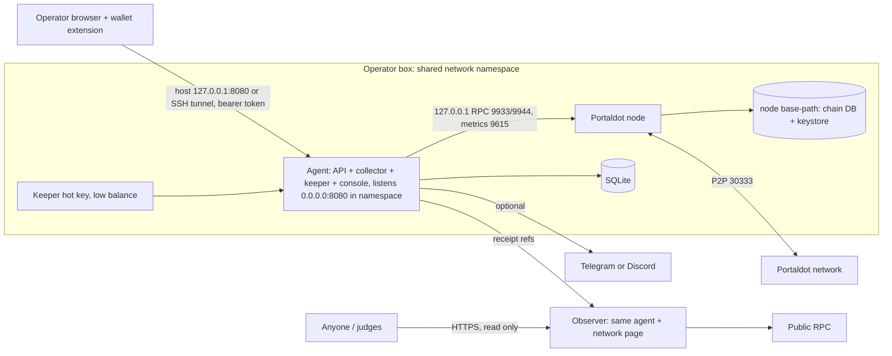

# PortalNode

PortalNode claims Portaldot staking rewards before they expire, for validators and their nominators, and tells operators when their node needs attention.

Portaldot Hacker House 2026 (DoraHacks), track **Node Operations & Tooling**. **Live demo: https://portalnode.timidan.xyz** (the agent on the V3 testnet, keeper on; the console is public and read-only). It runs as two containers on the operator's box: the official Portaldot node (pinned tarball, SHA-256 verified, non-root) and the PortalNode agent (keeper, collector, API and web console).

| Rubric | Where to look |
|---|---|
| Technical feasibility (30%) | [How it works](#how-it-works), [V3 testnet evidence](#v3-testnet-deployment-and-on-chain-evidence), [Security model](#security-model) |
| Innovation (30%) | [What is new](#what-is-new) |
| Ecosystem contribution (20%) | [Ecosystem](#ecosystem-contribution) |
| Business potential (20%) | [Business](#business-potential) |

## The problem

Anyone can trigger a validator's staking payout, but someone has to do it. Unclaimed rewards expire after **84 eras** (the history depth). On the V3 testnet an era is 6 hours, so the window is 21 days.

- **V3 testnet, 18 Oct 2026:** nobody was claiming. Every era from 1 to 24 was unclaimed for both validators: 48 payouts, an estimated 82.44 tPOT split by era points.
- **Mainnet (runtime 1002), at finalized block 2,724,352.** All amounts are gross estimates from Portaldot's own reward formula, which we checked against all 511 `staking.Reward` events of 10 historical payouts:
  - about 142,457 POT sat unclaimed inside the 84-era window;
  - about 6,051 POT was due to expire between 13 and 20 Oct. 96% of that belongs to the pools of a former validator (V11), whose 7 nominators still have 2.78M POT nominating it while it earns nothing;
  - big validators claim by hand, in `utility.batch` runs every week or two. Four small validators have no payout recorded since about era 3253.
- **Operators get little help.** 5 of 15 validator seats are empty with 0 waiting, 93.66% of stake sits on one validator, 0 of 10 validators set an identity, and there are no operator docs.

## How it works

1. **Chain adapter** (`agent/src/chain.ts`). It reads what the runtime can do from its shape (calls, storage, pallets), not from version labels. It picks a payout mode: `whole-era` (`payoutStakers`, runtime 1002) or `explicit-page` (`payoutStakersByPage`, V3). The genesis hash is checked on every connection.
2. **Collector** (`collector.ts`). On every new session, and every 10 minutes, it lists each claimable era (and page) inside the history window, with an estimate: the fork's stake-weighted formula on runtime 1002 (checked against real payouts), the validator's share of era points on V3. It also samples the node every 15 s (height, peers, sync, finality age) and builds a network snapshot: seats, stake concentration, finality margin from real authority weights.
3. **Keeper** (`keeper.ts`). For allowlisted validators only, it claims one payout per extrinsic, with one transaction in flight, earliest expiry first. Before signing it re-reads the era bounds, the claim marker and the runtime fingerprint, checks the fee policy, and writes the attempt to SQLite. Only then does it broadcast.
4. **Receipts.** A payout counts only when a finalized block holds our extrinsic and its reward event. Each one stores `(genesis, blockHash, extrinsicIndex, txHash)`, so anyone can re-check it.
5. **API and console** (`index.ts`, `web/`). The agent serves the console at `/console` (Overview, Rewards, Node, Network, Keeper) and a landing page at `/`.

| Route | Mode | Purpose |
|---|---|---|
| `GET /api/health`, `/api/node`, `/api/network` | both | Agent and node health; network snapshot with its block |
| `GET /api/rewards`, `/api/rewards/:validator` | both | Eras, statuses and recent attempts for allowlisted validators |
| `GET /api/receipts` | both | Receipt references, re-verified against finalized blocks |
| `GET /api/nominator/:address` | both | Nominator check: targets, active or not, commission, expiring rewards |
| `POST /api/keeper/enable`, `/disable`, `/claim-now`; `PUT /api/keeper/policy` | operator only | Keeper control. Needs the bearer token |

## Architecture

From [docs/ARCHITECTURE.md](docs/ARCHITECTURE.md):



**Operator mode** has the keeper key, the bearer token and the write routes. **Observer mode** is the same agent with no key, no secrets and no write routes registered. Not built yet: the wallet signing (it belongs to the setup wizard), and a hosted observer. See [Status](#status-and-roadmap). On the V3 testnet the agent connects to the public V3 endpoint, because the node container packages the mainnet binary.

## V3 testnet deployment and on-chain evidence

| Item | Value |
|---|---|
| Endpoint | `wss://test-node-v3.portaldot.dev` (runtime `portaldot-v3` 3002, metadata v16) |
| Explorer | https://node-console.portaldot.dev |
| Staking | Paged: `staking.payoutStakersByPage(stash, era, page)`, event `Rewarded` |
| Keeper hot key | `5HCFicFwm7GoC8R4swpr2WTFFvkH1WkzJQdVcsq6jMFDQVk3` (its own low-balance key) |
| Funding transfer to the keeper key | `0x7c17deb8f0db49dbb2727699270947215087030620c0499d5dd5bb5bf9e9ba73` |
| First payout (era 1, validator `5F4ZyJ…`, paid 1.7051 tPOT) | `0x9825048e2bcedfdad5f7b7b595aeebd556207086c077271b15103f0f8b128452` |
| Second payout (paid 1.7300 tPOT) | `0xf026e3fd00828643ecb739b7c1a1d0e06010e95457175a9f71d2c75d6c1bf11a` |

No contract is deployed. PortalNode works with Portaldot's native staking pallet, so the evidence is the hashes of native `payoutStakersByPage` extrinsics, which can be looked up on the V3 explorer. The runtime quoted a fee of 0.016 tPOT per payout.

### V3 testnet receipts (full list)

All 48 payouts, signed by the keeper key, each finalized with its `staking.Rewarded` event matched. Total paid to the validators: **82.4409 tPOT**; total fees: 0.7158 tPOT. An immediate rerun submitted nothing (`noop`).

<details><summary>Show all 48 receipts</summary>

| Era | Validator | Page | Tx hash | Finalized block hash | Extrinsic | Paid (tPOT) |
|---|---|---|---|---|---|---|
| 1 | 5F4ZyJ…BfYY | 0 | `0x9825048e2bcedfdad5f7b7b595aeebd556207086c077271b15103f0f8b128452` | `0x8a413a135c18c6ec2349f16a3c24aa635f359db1ce7cf642e66d89f04590f62f` | 1 | 1.7050 |
| 1 | 5Grj5u…hwjk | 0 | `0xf026e3fd00828643ecb739b7c1a1d0e06010e95457175a9f71d2c75d6c1bf11a` | `0x4ae8f1da4bf1c07ae8d2e2de5c40da6c3e9dffff1a9df085122f497be9cde237` | 1 | 1.7300 |
| 2 | 5F4ZyJ…BfYY | 0 | `0xfcd66d1769505c3be3989fca93537d5b6fcbab77e78f5e71ea2b8f2de3da133d` | `0x763b4144018f2279bf923ed7a7aeda0b452dc73e5b64dc8aa97362a2513b0996` | 1 | 1.7122 |
| 2 | 5Grj5u…hwjk | 0 | `0x509aa2b6a16547383752a6f33e17edcbe2e5ea14c06eb85e87e89f4f0da58df4` | `0xf33866976c85748964b4ecf00ae2547b29068f23f5899dff184b15b7c633a412` | 1 | 1.7227 |
| 3 | 5F4ZyJ…BfYY | 0 | `0x8378f884efab75ab0c5b95b91b01e99786f41f5ed480c60590bc4c42c4a985bd` | `0x2a8cd807b30371472ece1ba177df1444d12a9bc2575f8a4c3fc1cee71cc2bfc0` | 1 | 1.7468 |
| 3 | 5Grj5u…hwjk | 0 | `0x7c08150a9a7d652d617f84e1ddf604381e963b64f1e9f39bf82c645ae8c663bb` | `0x79c009a65b98f97a6bb4c2452b6aba6ae62661bb9ff6000aaf3a43f59ff97d00` | 1 | 1.6881 |
| 4 | 5F4ZyJ…BfYY | 0 | `0x85e44aa807a5acdcea7531b689eb132e6a593a0c8d163e18a95b70bb01ee4aab` | `0xf99a7b5ba569bc72119f539e3d66ed94bf101afc8219af49dc9392e3b6939530` | 1 | 1.7251 |
| 4 | 5Grj5u…hwjk | 0 | `0xba0a8dbd8d2f721a5ae800430ee9126914c033c79059d099b1912592045eb1a5` | `0xfa44d0fd7f32d0c1528321e0670fe3d68bdec914c81363e43061bc0b4c9770e9` | 1 | 1.7098 |
| 5 | 5F4ZyJ…BfYY | 0 | `0xf3dac013b111baa48933366bbdfde663a0399620637cd535c31d6b77a8e79c57` | `0x805a1508df93f0029ab30cb4c501a67fe1340dff0595fd09caac804149cfef91` | 1 | 1.7084 |
| 5 | 5Grj5u…hwjk | 0 | `0xb89763828c710160616318889ef0e36c540dee5db42f02780ef4842eb4df0996` | `0xeaef8241421d16542f28c4447627adb3e3a2a77ef7096e3dec92c7923f4e64df` | 1 | 1.7266 |
| 6 | 5F4ZyJ…BfYY | 0 | `0x7beb7d4f3785b79f6752a8fc551037ec11c50d3c732ac85657612c9d44428efe` | `0x3fbae791e573025d4a07bb5a5fafda9831bfa8f9b0ac615837a3b153f881a8c5` | 1 | 1.6772 |
| 6 | 5Grj5u…hwjk | 0 | `0xf135653c535e41d2d682cf57c379b4f96434d915090a87387776e2695fd1c46b` | `0x3941cffbfa7be2d178ba74a72ad4c4ce36daf25fff138a84dbb141f63e8159f7` | 1 | 1.7577 |
| 7 | 5F4ZyJ…BfYY | 0 | `0x664435299ac59c4083c675c233201204d911e5a892305dd5d3b4a8fb1c05a59c` | `0x85c42053ea33dc2f61dffeb10b3092a1138007e5ab1537d9b6cc35d04968d863` | 1 | 1.7362 |
| 7 | 5Grj5u…hwjk | 0 | `0x46a8f6f2e4abb7d122147f2d1d97493b66791373c366e56e6894d98be9bdb5b3` | `0x73b2922e33a9103eb9f1573e8278af24f7216088f38ff94bf2367615c820f443` | 1 | 1.6988 |
| 8 | 5F4ZyJ…BfYY | 0 | `0x8f580ba1193c042103c782b1ccb3ad1fbc949f0ee1d0d912eba16e7b9f39524b` | `0xcd58f52f1cabc626c0d8f19cbc9a40279c46c723349c9ec407cacdf428ab75e1` | 1 | 1.7175 |
| 8 | 5Grj5u…hwjk | 0 | `0x46e43052d2b34294fbcc8fa4c90af3aee60c08200e958d28c5091f5434f891b7` | `0xdb367c7ac5d5b3066aba8116d820065aa2505fbcec7375bb992bc1cf0b092d7d` | 1 | 1.7175 |
| 9 | 5F4ZyJ…BfYY | 0 | `0xfe89b04b286439f6bdca917fa0c523dfb85118f1cbda470a417ff12864fd2c1c` | `0x4442183e71b17e27b0694370bced9d2f248f82ce186e954a3b3b1f4507d012a9` | 1 | 1.7276 |
| 9 | 5Grj5u…hwjk | 0 | `0xd382074071b22fcb1de8a351b31a0d933372aae3b3dee2c255c185d5109e9272` | `0x7dfaea3c0f54df5c0cf44e6456da6b8b313842966f2c38ba16533a70a3a58ff3` | 1 | 1.7074 |
| 10 | 5F4ZyJ…BfYY | 0 | `0xe0699790abe65ee7aab409499d70105e03ac56494cf1b0b223f5e0336d798f5e` | `0xe9ddd9a4acf91e5022f2c3d4849bfabf24e472e9c8d77bd128874095a195e1a6` | 1 | 1.6954 |
| 10 | 5Grj5u…hwjk | 0 | `0x8dfe51475c6745e115a40df475cf5c7d5f6237981bfe3aee856733993889c68c` | `0x682ba6a7ec8360013db1236d7195f8b726a5e7da8337e9e971b6fc8a0cc2e631` | 1 | 1.7396 |
| 11 | 5F4ZyJ…BfYY | 0 | `0x0618771a6789b3f4aabe9c500c3b89e6630c6c82ef5ec4ea3def033ccce238c4` | `0xbf27dbd6ff7f27271295d2fa6b883f8288d0d8fdc3c4ecf27b6c0ba7aedf8e5d` | 1 | 1.7141 |
| 11 | 5Grj5u…hwjk | 0 | `0x639a83bed384676be143bbaffcade72580f5642b80df4a72cd659801647d2499` | `0x165a91f24371166573122324fb4f019096c92205f8e2d223790f27a18e0e343b` | 1 | 1.7208 |
| 12 | 5F4ZyJ…BfYY | 0 | `0x3653cdd8154ad5b403f36de1ae5e81c8f73c4a3e12a597b3afb5fbb4de7ddd1e` | `0xe5b15270542331b9c5f7e398a4ab095051a1bc08169238f8420c9d13071ceda6` | 1 | 1.6834 |
| 12 | 5Grj5u…hwjk | 0 | `0xa51a1a86a2685d50c9f8aa35bceeebe94d8cd0e8d249f00361aec30697976764` | `0xfebadd485feb2bca97a7112c81eb53f7f5efbb827c32a384bb9a99f858c79bda` | 1 | 1.7515 |
| 13 | 5F4ZyJ…BfYY | 0 | `0x8768db6643283a5be81da026c269e326f47d6910990d1f3f4f2f0bae57a320de` | `0x53f6d82f1db37c4faa4ba2f2e196ab026f141795fb5c5e52d0f4971f51e3f485` | 2 | 1.6925 |
| 13 | 5Grj5u…hwjk | 0 | `0xce6a8537128df5612634616bb7a3bcf9f2986ee5722216e91909bd493fd052a5` | `0x43d01286bc885e2595ea77f01c29a178101bd8265b1f031ceb5a027e4d4264e8` | 2 | 1.7425 |
| 14 | 5F4ZyJ…BfYY | 0 | `0x8fc80b2cebb251d75216c042e29c2a715738ca01844f8a31bbfc1f5c72bbbb52` | `0x9fa4280c12d8e9aa3e3a8ab5275ae1012914dc9d7bbf2881098d3d7c38a4fb29` | 1 | 1.7501 |
| 14 | 5Grj5u…hwjk | 0 | `0xdff3680ae8cd479a40c1b668ad1998fdee94f3b2f32b0b5f4328a4f42a1eb06a` | `0xd93b5b1a52b7c109aa14518ca78fa10ef4cf2263b8433b99158d81c76a960ad6` | 1 | 1.6848 |
| 15 | 5F4ZyJ…BfYY | 0 | `0x6b15d2577932ede8561577db2dfa825b0b5dd96645c59452811f81d4cdbd62ac` | `0xf333faf1d8e87569881440d7eca6a0827390a5e31dd829d9868daeebc26f050c` | 2 | 1.7127 |
| 15 | 5Grj5u…hwjk | 0 | `0xb2c958eabd5b728c1d4a9c961af8a01a89a8d3d48dee4f6a582600f6bb4967e7` | `0x4a187926aaedeff5b93a48e61ad8c30c19f7c3db820bd8a5e903dd15b0ba2414` | 1 | 1.7223 |
| 16 | 5F4ZyJ…BfYY | 0 | `0x15f6d270e97f77512a7c605263a42be566a2677532c697ec9acc3035113d054a` | `0xa17751a3845807410521760ad50fc38421b563bd76e5cea7121cb81c499162c2` | 1 | 1.7281 |
| 16 | 5Grj5u…hwjk | 0 | `0x63a07cef75a5c5e7ad07c549aebcd8196dfab2f3281d5ac6d237cdcd1171c99b` | `0xa0368bdeb0e7f136b2f37f7e0ae9809f552e0b2e7068d209b446d46933e05a55` | 1 | 1.7069 |
| 17 | 5F4ZyJ…BfYY | 0 | `0x15b0d2ee3fb040185852faac06849200375b0251a0bc6c79613dd3f54a994b71` | `0xe2e10b3f619e12acf3ab38227adac02b5207e84e79e4f4a481a7aebfef85556c` | 1 | 1.6674 |
| 17 | 5Grj5u…hwjk | 0 | `0x3c6513e71e0e34621dcf80d6f4d1e015ad2c75658563a1045b9e518123435d69` | `0xb5698471af6bf0a891d1e008c3d498333da319bca2a105a493ce28adce8c0594` | 1 | 1.7675 |
| 18 | 5F4ZyJ…BfYY | 0 | `0xd0cf0914adbcac5dc7efbcbfa8dcdc3bfc6a3f80a92d2d470dad760f7d630141` | `0xa417248b3dfb523e569ddd0735af3eb0fe3198ec623e0eca939470d9fca6f4b9` | 1 | 1.7694 |
| 18 | 5Grj5u…hwjk | 0 | `0xde3c55a02f873243d3885fb64de6d0c18de362daf11d3bd50259ac0c8834d973` | `0xaf932a43ec3bb52122c830941ad99d70c8b6d37ff8b07382dbfcb127ef4fda33` | 1 | 1.6656 |
| 19 | 5F4ZyJ…BfYY | 0 | `0x58244c39d9129531a26f8566d2fb3b1bd27bcb7a9792d712aeb0e24bd732e9e6` | `0xda405f65b0d26beac887a5857180668c5d2f0afcb480f96d8476894bffbe1de4` | 1 | 1.7055 |
| 19 | 5Grj5u…hwjk | 0 | `0x0c8e338a764003e95b2e894d391285577f236b2b03a861dddc65e7a04e587247` | `0x443310381d9098530975c1e28e7e139c6e2a69275391497cc34856a26d738678` | 1 | 1.7295 |
| 20 | 5F4ZyJ…BfYY | 0 | `0xfafa77ed18548733a4fde5dec7570c3416ad395988c3a37c34226d80498ba2ec` | `0x9e04f70ad852c3034c7e769d9b625a85c358ba91b448129d31beb260b50d6422` | 1 | 1.6810 |
| 20 | 5Grj5u…hwjk | 0 | `0xa983df1bed3bb096eaed3be7706f2e5c1dcd7d4393aa2f204b32860c171e5ce2` | `0x232d2ba9e843e0cfb6a1345d3d0bd1f1332113b2c3360c5bd38d711a105d6f6d` | 1 | 1.7539 |
| 21 | 5F4ZyJ…BfYY | 0 | `0x822d392ae79a50fc4596ce087bbe3f5bbdb2a6544937b95681f77ae910d1c505` | `0x3341f9801e203362b79dffd8061184a8e63e42d89e58cb9d6aa689872f7f4fed` | 1 | 1.6877 |
| 21 | 5Grj5u…hwjk | 0 | `0x2a2e1d0faa206d95388d4101d98c71ff8aa9da04cbdc05f9e21fb2bfec10d77f` | `0xb233152949497922ba6f8ee3c3981d8fe91311e1bb47bb93b10ce6a655a2f56b` | 1 | 1.7473 |
| 22 | 5F4ZyJ…BfYY | 0 | `0xb3da3fc427c3c237cef4ca2a26af8756f8cc946704c10e12fcb3d682195685ee` | `0xff18db4ca1774cc4378ba8e07b1b0dfebc03a9998c266add9fc639d6cbf7737a` | 1 | 1.6931 |
| 22 | 5Grj5u…hwjk | 0 | `0x03b404a61ba53ce9217162db0be23dbac93ac329a9b4175d25a38e70cbea2d58` | `0x5e63741f65a32f109e70e084d8ab16b6ef0dfb4828ff8e330f9d0605f39ff371` | 1 | 1.7419 |
| 23 | 5F4ZyJ…BfYY | 0 | `0xff3a6044c64a0d54c7408e3c529288d18bd81693de3dccf58d5360d6da85f1af` | `0xc5ed26199e00452b72928817a35cf67ca13e31b122ae3307f55dbe03a2997598` | 1 | 1.7314 |
| 23 | 5Grj5u…hwjk | 0 | `0xb6eb8f5ae139099b965346a4790bb1116c42e0dc32e6d73a24264782156ffd3d` | `0x8d39163409ecf5558fefe70f131227fe676bd6515359594a8351a08e4fde247a` | 1 | 1.7036 |
| 24 | 5F4ZyJ…BfYY | 0 | `0xb69bbad363baf605c6a1f4805affbe8767fc240bfa211d7435dbf8ebc9b7e787` | `0x739475d496dddcbc69ec71e893e31e91e55b385102494706c20d3553ad1e584a` | 1 | 1.7669 |
| 24 | 5Grj5u…hwjk | 0 | `0xcf77ce668bd798a723ed540a9c1941c12d293fa36a300b228aa163d49121542f` | `0x0ef938616150b4a8aa6b30c04bdf1f6e4fc99f81426f7758aeec519be873f565` | 1 | 1.6681 |

</details>

### Mainnet and dev chain

- **Mainnet (runtime 1002).** Our own node, synced from genesis on a VPS. Keeper signing on mainnet is off this round: the agent refuses to start in operator mode on the mainnet genesis, and the keeper refuses it again before it signs.
- **Dev chain (runtime 1002), [scripts/keeper-devchain-e2e.sh](scripts/keeper-devchain-e2e.sh).** The keeper, as a third party, claimed a validator's era (`0xcdd8b61b…981f16`). A rerun sent nothing. We crashed it right after it saved a signed attempt (exit 75). On restart, the attempt stayed unresolved inside its mortality window and nothing new was signed. After the window closed it was dropped, and the era was claimed again (`0x3357ba05…5525a1`). Earlier, a manual rerun of a claimed era failed with `staking.AlreadyClaimed` and still paid its fee, so the keeper never retries blindly. Full hashes and timings are in [docs/HARDENING-LOG.md](docs/HARDENING-LOG.md).

## What is new

- **One keeper for both runtimes.** It picks the payout mode from the runtime's shape, not a version label. It claimed whole eras on the runtime 1002 dev chain and paged payouts on V3.
- **Crash-safe claiming.** A signed attempt is saved before broadcast and settled only from a finalized receipt, so a crash does not lead to a blind resend. Unclear cases pause the keeper and raise an alert.
- **Portaldot's own reward maths.** The fork splits an era's payout by `points × ED + stake`, not by points as upstream Substrate does. Our formula reproduced 511 mainnet reward events to the base unit.
- **Honest network numbers.** The finality margin comes from real authority weights, every number shows its block, and a missing pallet shows as N/A, not zero.
- **Liveness the way the chain counts it.** A validator is online for a session if it authored a block or sent a heartbeat, exactly as `pallet-im-online` decides. PortalNode warns before the session ends when a validator has neither, while there is still time to fix it, and checks that the session keys on chain are loaded in the operator's own node.
- **Alerts that only a keeper can raise.** Telegram and Discord, one message when a problem starts and one when it clears: a payout nearing expiry, the keeper paused or low on fees, a runtime upgrade, a validator about to be reported offline, session keys not loaded, and a new commit in the upstream node repository (which publishes no releases or checksums).
- **Safe across runtime upgrades.** The keeper fingerprints the runtime by its code hash. If the code changes between planning and signing, it stops, alerts, and re-reads the call shapes before it signs again.

### How it compares

We read the code of the Node Ops entries we could find (18 Oct). Several watch the chain or score validators; one runs local chaos tests. None of them claims payouts or tracks reward expiry, and none computes liveness from `pallet-im-online` state. Where we overlap (node health, alerts, network risk), PortalNode reads everything from finalized chain state, labels estimates, and links every receipt to its block.

## Ecosystem contribution

- Nominators get paid even when their validator does not claim. On V3, 48 payouts sat unclaimed until the keeper started.
- A read-only nominator check: paste an address to see whether its validators are active, their commission, and which rewards expire when.
- An open, pinned, verified way to run the official node, with its provenance in [deploy/provenance.json](deploy/provenance.json).

## Business potential

- **Users:** validator operators who want payouts on time, nominators of slow validators, and the foundation's node program, which needs a scorecard of healthy nodes.
- **Revenue options (not tested):** a small keeper fee per claim, or a hosted plan that runs the keeper and alerts for operators who do not want a box.
- The agent is self-hosted, so an operator never hands a stash key to us.

## Quick start

Requirements: Docker with Compose for the node, Node.js 22 for running the agent from source.

**A. Mainnet node with an observer console (Docker).** The agent starts in observer mode (read-only); operator mode refuses mainnet this round.

```bash
cd deploy
cp .env.example .env
docker compose up -d --build
ssh -L 8080:127.0.0.1:8080 your-server      # from your laptop, if the box is remote
# open http://127.0.0.1:8080/console
```

The node syncs mainnet from genesis. In our test that ran at about 190 blocks/s, roughly 4 hours.

**B. Keeper on the V3 testnet (from source).**

```bash
(cd web && npm ci && npm run build)
cd agent && npm ci
# 1. Observer first: read the chain and its genesis hash (curl from a second terminal)
PORTALNODE_RPC=wss://test-node-v3.portaldot.dev npm run dev
curl -s http://127.0.0.1:8080/api/network | jq -r .genesis
# 2. Stop the observer. Operator: a new low-balance key, never your stash.
#    keeper.json contains {"suri": "<secret phrase>"}; run chmod 600 keeper.json
export PORTALNODE_MODE=operator PORTALNODE_RPC=wss://test-node-v3.portaldot.dev
export PORTALNODE_GENESIS=<the genesis from step 1>
export PORTALNODE_KEEPER_FILE=$PWD/keeper.json PORTALNODE_ALLOWLIST=<stash>,<stash>
export PORTALNODE_TOKEN=$(openssl rand -hex 32); echo "$PORTALNODE_TOKEN"
export PORTALNODE_MAX_FEE=5 PORTALNODE_BUDGET_24H=50 PORTALNODE_MIN_RESERVE=1   # values from the e2e script; tighten for real funds
npm run dev
```

Then open `/console`, go to **Keeper**, paste the token and press **Turn on**. Or run `curl -X POST -H "Authorization: Bearer $PORTALNODE_TOKEN" http://127.0.0.1:8080/api/keeper/enable`. Set `PORTALNODE_KEEPER=on` to turn the keeper on at every start; otherwise it starts off. A fee policy set in the console lasts only until restart, so use the three env vars for a policy that stays. `npm run keeper:once` signs at most one payout and exits.

| Variable | Default | Purpose |
|---|---|---|
| `PORTALNODE_MODE` | `observer` | `operator` registers write routes and allows signing |
| `PORTALNODE_RPC` | `ws://127.0.0.1:9944` | Chain WebSocket endpoint |
| `PORTALNODE_GENESIS` | none | Required in operator mode. Must match the chain; mainnet is refused |
| `PORTALNODE_KEEPER_FILE` | none | JSON with `suri` or `secretPhrase`; must be `chmod 600` |
| `PORTALNODE_ALLOWLIST` | empty | Validator stashes the keeper may pay out for; empty means plan only |
| `PORTALNODE_TOKEN` | none | Bearer token for write routes, at least 32 characters |
| `PORTALNODE_MAX_FEE`, `PORTALNODE_BUDGET_24H`, `PORTALNODE_MIN_RESERVE` | none | Fee policy in POT, up to 14 decimals |
| `PORTALNODE_NODE_RPC`, `PORTALNODE_METRICS` | none | Local node HTTP RPC and metrics; loopback URLs only |
| `PORTALNODE_DB` | `./portalnode.sqlite` | SQLite file |
| `PORTALNODE_KEEPER` | off | `on` turns the keeper on at start (operator mode, fee policy and key required) |
| `PORTALNODE_UPSTREAM_CHECK` | on | Every 6 h, alert when `portaldotVolunteer/Portaldot-node` has a commit past the pinned one (a new mainnet or V3 binary); `off` disables it |
| `PORT` | `8080` | Listen port |
| `PORTALNODE_ALLOWED_HOSTS`, `PORTALNODE_ALLOWED_ORIGINS` | localhost and 127.0.0.1 | Host and Origin allowlists for write routes |
| `PORTALNODE_TELEGRAM_BOT_TOKEN`, `PORTALNODE_TELEGRAM_CHAT_ID` | none | Telegram alerts: a bot token from @BotFather and the chat id. Set both |
| `PORTALNODE_DISCORD_WEBHOOK` | none | Discord alerts: an `https://discord.com/api/webhooks/...` URL |
| `PORTALNODE_ALERT_EXPIRY_ERAS` | `7` | Alert when an allowlisted payout is this many eras from expiry |
| `PORTALNODE_ALERT_PAYOUTS` | off | `on` also sends a message for each payout the keeper claims |
| `NODE_NAME` | `portalnode` | Node name (Compose) |

## Security model

- **Hot key only.** The keeper key pays fees and nothing else. Payout calls are open to any account, and the chain pays each stash's own reward destination. No stash or controller key ever touches the box. The key file must be owner-only, or the keeper refuses to load it.
- **Fee policy.** Signing needs a maximum fee per transaction, a rolling 24-hour budget and a minimum reserve of at least the existential deposit. If the balance would fall below the reserve, the keeper turns itself off and raises a critical alert. These are application limits, not an on-chain cap: keep the balance small and top it up by hand.
- **Durable attempts.** One transaction in flight, enforced by a unique index. Each attempt (nonce, runtime fingerprint, 64-block mortality window, fee, tx hash) is saved before broadcast. On restart: found in a finalized block, settle it; nonce unchanged and window passed, drop and re-plan; anything else, or a runtime change, pause and alert. Oversize calls, expired eras and eras claimed by someone else are recorded once and never retried.
- **Mainnet signing off.** Checked twice, in `chain.ts` at connect and in `keeper.ts` before signing.
- **Console access.** Compose publishes port 8080 on the host's loopback only; reach it over an SSH tunnel. Write routes need the bearer token (constant-time compare) in the `Authorization` header, plus Host and Origin allowlists. Observer mode never registers them. Read routes have no token and rely on the loopback binding.
- **Containers.** The node tarball is pinned to an upstream commit and its SHA-256 is checked before extraction. The node runs as uid 10001 and the agent as `node`. Both containers drop all capabilities and set `no-new-privileges`; the agent's root filesystem is read-only. Node RPC and metrics stay on the shared namespace's loopback, with no external RPC flags.
- **Known limit.** The agent runs on the same box, so it cannot report the box itself going down.

## Development records

All commits fall inside the coding window (14 Oct to 6 Nov 2026). Experiments, failures and fixes are in [docs/HARDENING-LOG.md](docs/HARDENING-LOG.md); the design is in [docs/ARCHITECTURE.md](docs/ARCHITECTURE.md) and [docs/PLAN.md](docs/PLAN.md).

| Date (UTC+1) | Commit | Change |
|---|---|---|
| 15 Oct 17:33 | `7c13b76` | Start PortalNode: design docs, dev-chain bootstrap and the Night shift landing |
| 15 Oct 18:10 | `dee2055` | Add the PortalNode agent and container deploy |
| 15 Oct 18:30 | `2d996e8` | Add the operator console and a keeper end-to-end script |
| 15 Oct 18:51 | `be85a47` | Add the night-shift punch clock figure to the landing page |
| 15 Oct 23:46 | `628602b` | Fix keeper broadcast and one-shot exit |
| 16 Oct 00:52 | `cdf6b36` | Rework the punch clock as a connected mechanism that plays on its own |
| 16 Oct 01:41 | `2aa1f85` | Keep an unsent payout attempt unresolved until its window closes |
| 18 Oct 17:03 | `87002f2` | Support paged staking payouts on the V3 testnet |
| 18 Oct 17:26 | `f35bc44` | Claim automatically while the keeper is enabled, and read V3 weights |

## Dependencies and SDKs

| Part | Dependency | Licence or source |
|---|---|---|
| Node | Official Portaldot node tarball, `portaldotVolunteer/Portaldot-node` commit `1ff0b2b3dc85…`, SHA-256 `539a43dbb37d…7ad0a` | Upstream; see [deploy/provenance.json](deploy/provenance.json) |
| Agent | `@polkadot/api` 17.0.2, `@polkadot/keyring` 14.0.3, `@polkadot/util-crypto` 14.0.3 | Chain access and signing |
| Agent | `express` ^5.1.0, `better-sqlite3` ^12.2.0; dev: `typescript`, `tsx` | API and storage |
| Web | `react` / `react-dom` 19.3.0, `vite` 6.4.3, `tailwindcss` ^4.3.3, `three` 0.186.1, `motion` ^13.4.1, `@phosphor-icons/react` ^2.1.7, Geist and Geist Mono via `@fontsource-variable` | Console and landing |
| Web | Anatomy kit by Ryan ([wheresryan22/anatomy](https://github.com/wheresryan22/anatomy)) in `web/src/anatomy/iso` | MIT, [LICENSE](web/src/anatomy/iso/LICENSE) |
| Web | Fibre-optic footage from Mixkit | Mixkit Stock Video Free License, [SOURCES.md](web/public/footage/SOURCES.md) |
| Images | `ubuntu:22.04`, `node:22-slim` | Docker Hub |

Not used: substrate-payctl and the DAppNode Polkadot package template.

## Status and roadmap

**Works today:** chain adapter for runtime 1002 and V3; collector; keeper with durable attempts and fee policy; SQLite receipts; API; console; read-only nominator check; Compose with the pinned mainnet node (agent in observer mode); signed payouts on the V3 testnet; per-validator liveness from chain state (blocks authored, heartbeats, era points, will-be-reported-offline forecast) and a session-keys-loaded check against the operator's node; Telegram and Discord alerts (one message when a problem starts, one when it clears, a test button in the console), raised for expiring payouts, keeper pauses and low balance, runtime upgrades, offline risk and keys not loaded. Alert delivery is tested against stubbed endpoints; a real bot and webhook are not wired yet.

**Not built yet:**
- Setup wizard (bond, session keys, validate) and wallet signing.
- DAppNode package.

**Next, by 6 Nov:** setup wizard with one proven wallet, the public observer page with verified receipts, update signals. DAppNode only if its networking keeps node RPC private.

## Licence

To be added. The anatomy kit in `web/src/anatomy/iso` stays under its MIT licence.
