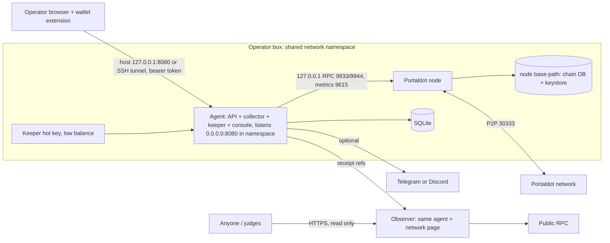

# PortalNode architecture

PortalNode claims Portaldot staking rewards before they expire, for validators and their nominators, and tells operators when their node needs attention; its installer sets up new validators from a fresh server.

Merged 13 Oct 2026 from Codex's system design (`~/Documents/hackathon-research/portaldot-2026-11-06/ARCHITECTURE-codex.md`), Claude's product design (`ARCHITECTURE-claude.md`), Agy's pain-point research (`agy-painpoints.md`), hands-on experiments (`HARDENING-LOG.md`) and Codex's adversarial review (`REVIEW-codex-hardening.md`, 18 findings, all accepted below).

## Decision
Two containers on the operator's box: the **Portaldot node**, and one **agent** (TypeScript, Express 5, better-sqlite3, @polkadot/api) that serves the built React console. One chain adapter, one keeper queue, one SQLite file. The public instance for judges is the same agent in `observer` mode: no keys, no secret mount, no write routes.

## Why each part exists (from evidence)
| Pain (evidence) | Part |
|---|---|
| Unclaimed rewards, validated: **~142,457 POT** gross sits unclaimed inside the 84-era window and **~6,051 POT** expires 13–20 Oct (finalized block 2,724,352; Codex's fork-formula recount matches all 511 `Reward` events in 10 historical payouts exactly). **96% of the expiring amount is the former validator V11's pools**, i.e. the rewards of the same 7 nominators whose 2.78M POT now earns nothing. Big validators do claim, in manual `utility.batch` runs every week or two; four small ones have no payout recorded since about era 3253 (a ledger-marker observation, not a proven last-payment date) | Keeper; nominator check |
| No operator docs at all; 5 of 15 seats empty, 0 waiting (docs repo, mainnet) | Installer + wizard |
| 2.78M POT nominating a validator that isn't active (and those nominators' past rewards are the bulk of what's expiring); 3 validators at 100% commission (mainnet) | Nominator check |
| 93.66% of stake on one validator (V2); 0 of 10 identities; finality halts if 4 of 10 go down (mainnet, equal weights) | Security panel |
| Unversioned tarballs overwritten on `main`; mainnet binary dated Jun 2021; source (1001) lags the live runtime (1002) | Pinned install + update signals |
| RPC outages with no way to tell local from network-wide (potscan, PortalPulse, atlas READMEs) | Health + alerts |
We found almost no public operator discussion of Portaldot in the sample we reviewed (Agy). The evidence is on-chain data (strong) and other teams' READMEs (medium), not user interviews.

## Reward maths (Portaldot differs from upstream)
Portaldot's fork splits an era's payout by `(points × ED + validator total stake) ÷ (total points × ED + era total stake)`, with ED = 1 POT (`frame/staking/src/lib.rs` @ ba459365, `payout_stakers`). Upstream Substrate uses points only. Stake dominates, so low-stake validators earn little however many blocks they produce. The formula, including the fork's Perbill construction and round-half-down multiplication, reproduced all 511 `staking.Reward` events of 10 historical mainnet payouts to the base unit (receipts in `codex-numbers-corrected.md`; runtime 1002, same `:code` hash at every block checked). Displayed amounts are gross validator + nominator pools and labelled estimates until our own receipts exist. This validates runtime 1002 only, not V3.

## Chain adapter
- Detects capabilities from the runtime's **shape**, never from "V2/V3" labels or the metadata version: call arguments, storage types, constants, pallets, RPC methods. Each capability is `absent | unverified | supported` with a reason. Detection is cached per genesis + runtime fingerprint; all reads in one pass use one finalized block hash. Genesis is checked on every (re)connection.
- Payout modes: `whole-era` (two-argument `payout_stakers` + ledger `claimedRewards`), `explicit-page` (`payout_stakers_by_page`, preferred when present), `next-page` (two-argument call on a paged runtime pays the next unpaid page **at execution**). In `next-page` mode the page is attributed from each finalized receipt, never assumed; if attribution isn't unambiguous, automatic writes stay off.
- Missing staking or im-online is a stated N/A in the UI, never a zero or an alarm.
- Metadata V13 carries no type definitions, so polkadot.js falls back to its own by name. Runtime 1002 needs exactly one verified override, `DispatchErrorModule: {index: u8, error: u8}`; `ValidatorPrefs` is already the modern `{commission, blocked}` (HARDENING-LOG #7). Every override ships with a decode test against real chain data.
- Receipts are decoded with the runtime that executed their block, not today's metadata.

## Keeper
1. **Eligibility:** era `e` with `max(0, CurrentEra − HistoryDepth) ≤ e < ActiveEra`, reward funded, exposure present, validator had points, not in the claim marker. Never the unfinished era; "no exposure" is never "unclaimed".
2. **Order:** earliest expiry, then era, validator, page. Claim as soon as an era is claimable; expiry is urgency, not the schedule.
3. **Scope:** spends only for the operator's validator allowlist. Network-wide claiming is a separate opt-in.
4. **One payout per extrinsic, one tx in flight.** Before signing, re-read the era bounds, claim marker and runtime fingerprint. Weight and encoded length are checked against the runtime's Normal-class limits; oversize units are marked non-retryable, not retried.
5. **Durable attempt:** the attempt (nonce, runtime fingerprint, mortality birth/death, fee reservation, tx hash) is written before broadcast and stays unresolved across restarts until settled:
   - finalized inclusion found within its mortality window → settle from the receipt;
   - account nonce unchanged and the mortality window has passed → dropped, re-plan;
   - anything else (nonce consumed elsewhere, history pruned, runtime changed while pending) → **pause signing and alert for manual recovery**.
   A target that someone else claimed in the meantime doesn't release an in-flight attempt.
   `ponytail: no automatic rebroadcast of signed bytes; ambiguous cases pause for the operator. Add byte-exact rebroadcast if pauses prove frequent.`
6. **Fees:** `maxFeePerTx`, rolling 24 h budget and minimum reserve (≥ existential deposit) must be accepted before signing is enabled. Reservations persist with the attempt; failed and unresolved attempts count against the budget; fees are charged at inclusion time; the check uses transferable balance after the reservation. Insufficient funds pause signing until funding changes. These are application limits, not an on-chain cap: keep the key's balance small and fund it by hand. No auto top-up.
7. **Terminal outcomes:** expired (`InvalidEraToReward`), already claimed by someone else, oversize, unsupported shape. Each is recorded once and never retried.
8. **Proof:** "rescued POT" counts only `staking.Reward` events from finalized blocks, attributed to our extrinsic. Each payout exports a receipt reference `(genesis, blockHash, extrinsicIndex, txHash)`; the observer re-verifies these read-only to show them publicly. A tx hash alone can't be looked up over standard RPC.

## Health
- Online = an im-online heartbeat **or** authored blocks in the session (the runtime's own rule). "No evidence yet" is different from "offline"; alerts wait for the session to end.
- Sources: node metrics (heights, peers, role), `system_health` / `system_syncState`, finalized-head age, session and era state.
- The agent runs on the same box, so it can't report the box itself going down. That's stated in the UI. Whole-host monitoring would need an outside observer and is out of scope.

## Security
1. **No stash or controller key ever touches the box.** Wizard calls are built by the agent, shown decoded, and signed in the operator's wallet. Only wallet flows proven end to end on the target runtime are offered (see Wizard).
2. **Node RPC and metrics stay on the namespace's loopback.** The node runs with the default `--rpc-methods Auto` and no external RPC/WS flags: an external flag silently flips Auto to safe and hides `author_rotateKeys`, and `--rpc-methods safe` hides it outright (HARDENING-LOG #4). The agent exposes typed operations, never a raw RPC proxy, Docker socket or keystore mount. Because it can reach unsafe RPC, the agent is a privileged component; key rotation is an authenticated, explicit setup action. Install check: unsafe RPC unreachable from host, LAN and public ingress.
3. **Console access:** the agent listens on the namespace's interface (0.0.0.0:8080); Compose publishes it on the **host's** 127.0.0.1:8080 via the node service. Remote access is by SSH tunnel. Every API call needs a high-entropy bearer token generated at install, sent in the `Authorization` header only (never in URLs, logs or static assets), with explicit Host and Origin allowlists. No unauthenticated mutations.
4. **Keeper key:** owner-only file permissions, non-root agent, small balance, no proxy, staking or sudo rights. A compromised agent can spend that balance; nothing more.
5. **Observer:** started without any secret mount; write routes are never registered (not just hidden).

## Packaging
- `docker-compose.yml`: `node` (Ubuntu base + official tarball, pinned commit + SHA-256 verified before extraction, `chmod +x`, `--chain pot_mainnet_spec_raw.json` from the tarball, archive pruning for validators, persistent base-path volume holding chain DB **and keystore**, non-root, publishes P2P 30333 and host-loopback 8080) and `agent` (`network_mode: service:node`, read-only root, state volume).
- Replacing the node container: keep the base-path volume, recreate the agent so it joins the new namespace, then verify the registered session keys still exist in the keystore. One active validator per key set, ever; a restored backup is never run alongside the original.
- `provenance.json`: tarball URL, commit, SHA-256, binary hash, `--version` output, genesis.
- Two update signals, alert only, never auto-upgrade: the upstream tarball's hash changes; the chain's spec/transaction version or metadata changes. On a runtime change: pause signing, keep pending attempts and their old fingerprint, resolve them, re-detect, invalidate unsigned wizard intents.
- DAppNode package (from DAppNode's Polkadot template, credited) is conditional. Agy reports DAppNode's manager injects its own network into every service, which can't be combined with `network_mode: service:node` (UNVERIFIED; check on a real DAppNode). If so, node and agent talk over a bridge, RPC isn't loopback, `Auto` falls back to safe, and key rotation is unavailable. The DAppNode variant would then ship node + keeper + health only, without the setup wizard, and say so.
- Validators keep archive pruning: this binary's `--help` says validators default to archive and need `--unsafe-pruning` otherwise. Agy's "validators don't need archive" describes modern SDKs, not 2.0.

## Wizard
- **Preflight before any signature:** network and genesis; existing ledger (resume from it); `MinValidatorBond ≤ bond ≤ MaxValidatorBond` (mainnet 5,000–30,000 POT; the chain reports both failures as `InsufficientBond`, the wizard says which bound); fee funds for each signer; candidate limits.
- **Accounts:** resolve `Bonded(stash) → controller`, including stash == controller. Each call is signed by the account its origin needs.
- **Keys:** generated on the node that will run them, then `NextKeys` checked against that node before `validate`. Keys that aren't on a running node can halt a small chain if elected.
- **Status:** candidate, queued and active shown separately. "Validator" is claimed only after actual session membership with keys present. An empty seat isn't a guarantee of election.
- **Sync:** shows `system_syncState` progress (a full mainnet sync took ~4 h in testing).
- **Wallets:** one exact wallet, version and browser flow is proven early on the target runtime (connect → decoded call → signed → finalized). Only that path is offered at first. If none works, wallet signing in the wizard is disabled and a separately verified signing route is documented. The server never asks for a seed.
  - First candidate: Portaldot's own extension (`portaldotVolunteer/Portaldot-Extension`, Manifest V3, injects as `portaldot extension`; signing on 1002 untested). Fallback: the Polkadot.js extension.
  - Metadata V13 has no type registry, so extensions will likely show raw hex for our calls (Agy). The console therefore shows its own decoded preview before asking for a signature: pallet, call, arguments, signer role, fee, mortality, and the hex the wallet will show.
- Identity is optional.

## Data (five tables for check-in)
| Table | Holds |
|---|---|
| `payouts` | genesis, validator, era, page (−1 = whole era), status (incl. terminal states), estimate (fork formula), verified paid amount, reason. PK (genesis, validator, era, page) |
| `tx_attempts` | logical key, signer, nonce, runtime fingerprint, call hex, tx hash (unique), mortality birth/death, fee reserved / quoted / actual, reserved_at, charged_at, status (unresolved / settled / dropped / paused), finalized block, extrinsic index, events, error |
| `alerts` | dedupe key (unique), kind, severity, first/last seen, resolved, evidence, delivery state |
| `node_samples` | sampled_at, reachable, syncing, peers, best/finalized height, finality age, heartbeat seen and authored count (NULL if N/A), error. 7-day retention |
| `network_snapshots` | finalized hash, era, validator count vs target, stake concentration, authority weights, identity and offence counts, capability gaps |
`eras` and `wizard_steps` are added when the wizard lands. Balances are stored as decimal text, accounts as hex. Chain state wins any disagreement.

## Honesty rules for every judge-facing number
- Stake concentration is not voting power: GRANDPA weight is per validator. Compute the finality threshold from actual weights; say "4 of 10" only while weights are equal.
- Addresses are not operators. Shared patterns are leads, not proof of one owner.
- No im-online on a network → heartbeats are N/A, never an alarm.
- Old offence reports are history, not a current outage.
- Every number shows its block and age. An unreachable source never shows as a healthy zero.
- Estimates say so. Monetary headlines only after validation against real reward events.
- "No payout recorded since era X", not "stopped claiming". "None found in the sample we reviewed", not "none exist". No claims of being first.

## Scope by date
| By | Ships |
|---|---|
| **Check-in, 24 Oct** (ugly but real) | One proven V3 payout mode with a positive payout and a no-op rerun **before any UI work**; durable attempts + fee policy; one Rewards view with tx hashes; small read-only network panel; Compose on a VPS; public repo, README, dev records, this diagram; ≤3 min proof video; dependency disclosure |
| **Final, 6 Nov** (committed) | Console (Overview, Rewards, Network, Setup wizard with **one** proven wallet); public network page with verified receipts and a read-only **nominator check** (paste an address: is your validator active, what commission, which of your rewards expire when);  **one** alert channel (Telegram bot: outbound HTTPS only, no public server; rate-limited and deduplicated); update signals; final video, pitch deck with business case |
| **Final, conditional** | DAppNode package (if networking stays private); nominator check actions (wallet-signed claim of expiring rewards, re-nominate); OpenGov upgrade radar (if V3 has OpenGov); second wallet or alert channel; art-rich visual expansion |

## Non-goals
Custody of any stash key; nomination autopilot with proxy rights; fleet orchestration; automatic binary upgrades; whole-host outage detection; hardware box; contracts deployed only to fill the form; Redis, Postgres, Grafana or a separate indexer.
